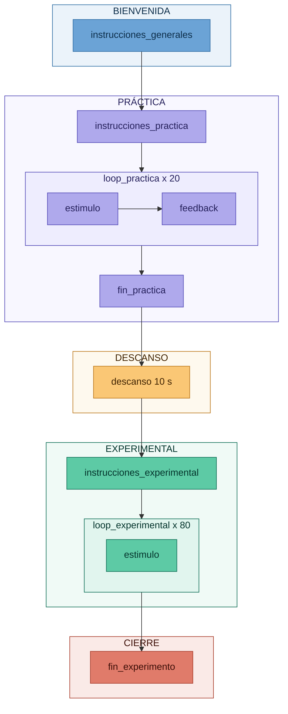

# Taller 4 — Tarea Go/No-Go

- **Asignatura:** Investigación e Intervención desde las Neurociencias Aplicadas  
- **Ciclo:** 2026-1  
- **Autor:** Marcelo Landa

---

## Descripción

Materiales del Taller 4 del curso, centrado en el diseño e implementación de la tarea Go/No-Go en PsychoPy Builder. La tarea Go/No-Go es un paradigma de control inhibitorio en el que el participante debe responder ante un estímulo frecuente (Go) e inhibir su respuesta ante un estímulo infrecuente (No-Go). La alta proporción de trials Go genera una tendencia prepotente a responder, lo que hace que la inhibición en los trials No-Go sea cognitivamente demandante. El control inhibitorio es una de las tres funciones ejecutivas centrales revisadas por Diamond (2013), y constituye la función directamente medida por este paradigma. Wessel (2018) es la referencia metodológica utilizada en el taller.

> **Nota:** El archivo `.psyexp` será completado durante el taller. Al finalizar la semana se subirá la versión resuelta al repositorio.

---

## Cómo descargar los materiales

1. Hacer clic en el botón verde **`< > Code`** en la parte superior de esta página
2. Seleccionar **`Download ZIP`**
3. Descomprimir el archivo en tu computadora
4. Abrir PsychoPy Builder y cargar el archivo `gonogo_task.psyexp`

> **Importante:** No mover ni renombrar ninguna carpeta. PsychoPy necesita encontrar los archivos en `media/stim/` e `media/instructions/` exactamente como están configurados.

---

## Estructura del repositorio

```
taller_4_gonogo/
│
├── gonogo_task.psyexp                  # Archivo del experimento (se completa en el taller)
│
├── conditions/
│   ├── practica.xlsx                  # 20 trials — 16 Go (80%) + 4 No-Go (20%)
│   └── experimental.xlsx             # 80 trials — 64 Go (80%) + 16 No-Go (20%)
│
├── media/
│   ├── instructions/
│   │   ├── 01_instrucciones.png
│   │   ├── 02_instrucciones_practica.png
│   │   ├── 03_fin_practica.png
│   │   ├── 04_descanso.png
│   │   ├── 05_instrucciones_experimental.png
│   │   └── 06_fin_experimento.png
│   └── stim/
│       ├── go.png                     # Círculo verde (#27AE60) — 500×500 px
│       └── nogo.png                   # Cuadrado rojo (#C0392B) — 500×500 px
│
├── docs/
│   ├── instrucciones_gonogo.docx      # Instrucciones por pantalla con notas técnicas
│   └── guia_materiales_taller4.docx  # Guía completa de materiales del taller
│
└── README.md
```

---

## Diseño de la tarea

| Parámetro | Valor |
|---|---|
| Paradigma | Go/No-Go — control inhibitorio |
| Versión | Versión 4 de Wessel (2018): rare No-Go + ritmo rápido |
| Estímulo Go | Círculo verde — responder |
| Estímulo No-Go | Cuadrado rojo — inhibir |
| Tecla de respuesta (Go) | Barra espaciadora |
| Proporción | 80% Go / 20% No-Go |
| Trials de práctica | 20 (16 Go + 4 No-Go) con feedback |
| Trials experimentales | 80 (64 Go + 16 No-Go) sin feedback |
| Duración del estímulo | Hasta 1000 ms o hasta respuesta |
| Duración del trial (ITI incluido) | 1500 ms |
| Variables de la tarea | RT en Go (ms), errores de comisión (%), errores de omisión (%) |

### Flujo de la tarea



---

## Análisis de resultados

Una vez completada la tarea, el CSV generado por PsychoPy puede procesarse en la aplicación web del curso:

**🔗 [mlandaf.github.io/taller_4_resultados](https://mlandaf.github.io/taller_4_resultados)**

No se requiere instalar ningún software adicional. Solo arrastra tu archivo CSV al navegador.

---

## Referencias

Diamond, A. (2013). Executive functions. *Annual Review of Psychology, 64*, 135–168. https://doi.org/10.1146/annurev-psych-113011-143750

Wessel, J. R. (2018). Prepotent motor activity and inhibitory control demands in different variants of the go/no-go paradigm. *Psychophysiology, 55*(3), e12871. https://doi.org/10.1111/psyp.12871

Peirce, J. W., Gray, J. R., Simpson, S., MacAskill, M. R., Hochenberger, R., Sogo, H., Kastman, E., & Lindelov, J. (2019). PsychoPy2: Experiments in behavior made easy. *Behavior Research Methods*. https://doi.org/10.3758/s13428-018-01193-y

---

## Contacto

**Marcelo Landa**  
Asistente de cátedra — Investigación e Intervención desde las Neurociencias Aplicadas  
Universidad de Lima
