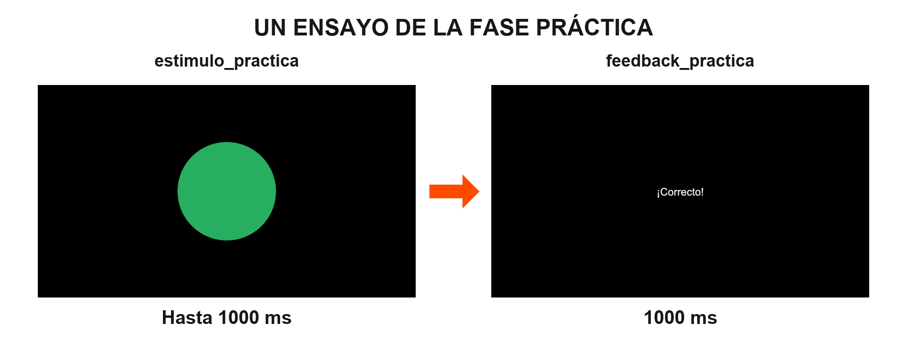
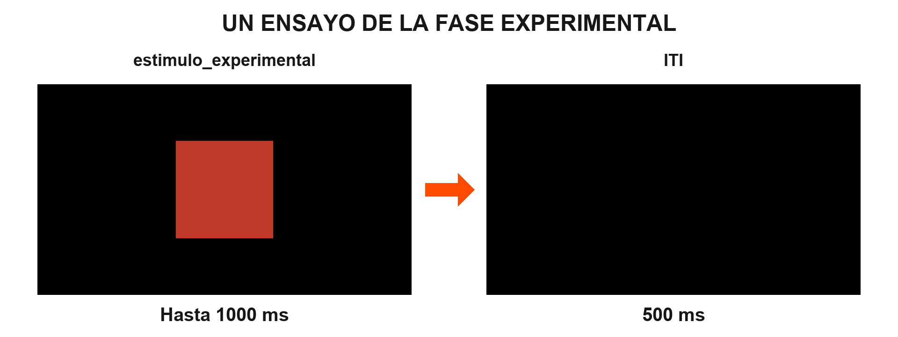
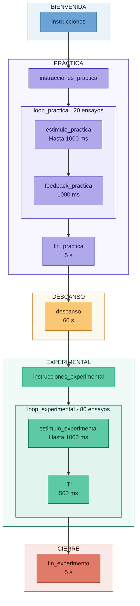

# Taller 4 - Tarea Go/No-Go

- **Asignatura:** Investigación e Intervención desde las Neurociencias Aplicadas
- **Ciclo:** 2026-2
- **Autor:** Marcelo Landa

---

## Descripción

Este repositorio contiene los **materiales del Taller 4** del curso, centrado en el diseño e implementación de una tarea Go/No-Go en PsychoPy Builder. Durante el taller construiremos la tarea en la que el participante debe presionar la **barra espaciadora ante un círculo verde (Go)** y **no presionar ninguna tecla ante un cuadrado rojo (No-Go)**. La mayor frecuencia de ensayos Go favorece una tendencia a responder que debe inhibirse ante el estímulo No-Go.

La tarea tendrá una fase de práctica con feedback y una fase experimental sin feedback. El control inhibitorio se aborda a partir de Diamond (2013), y Wessel (2018) se utiliza como referencia metodológica. Los parámetros que se describen aquí corresponden a la adaptación didáctica del curso.

> **Nota:** El archivo `gonogo_task.psyexp` está vacío y se completará en conjunto durante el taller. Las hojas de condiciones, las instrucciones, las imágenes de los estímulos y las figuras de las secuencias están disponibles como materiales de apoyo.

### Secuencia del ensayo de práctica



**Estímulo y respuesta (hasta 1000 ms) → Feedback (1000 ms).**

### Secuencia del ensayo experimental



**Estímulo y respuesta (hasta 1000 ms) → ITI en negro (500 ms).**

La primera pulsación de la barra espaciadora termina la presentación del estímulo y da paso al feedback o al ITI. Si no hay respuesta, el estímulo permanece hasta completar los 1000 ms. Esto también se aplica a los ensayos No-Go: no responder es correcto; pulsar espacio constituye un error y termina la presentación. La tarea no utiliza cruz de fijación.

---

## Cómo descargar los materiales

1. Hacer clic en el botón verde **`< > Code`** en la parte superior de esta página.
2. Seleccionar **`Download ZIP`**.
3. Descomprimir el archivo en tu computadora.
4. Abrir PsychoPy Builder y cargar `gonogo_task.psyexp`.
5. Consultar `docs/instrucciones_gonogo.docx` para revisar los textos, tiempos y forma de avance de las pantallas.
6. Completar la tarea durante el taller, siguiendo la explicación del docente y las indicaciones del caso.

> **Importante:** Conservar los nombres de los archivos y la estructura de carpetas. PsychoPy utiliza rutas relativas para encontrar las hojas de condiciones y las imágenes de los estímulos.

---

## Estructura del repositorio

```text
taller_4_FES/
├── gonogo_task.psyexp                       # Experimento vacío (se completa en el taller)
├── conditions/
│   ├── condiciones_practica.xlsx            # 20 ensayos: 16 Go y 4 No-Go
│   └── condiciones_experimental.xlsx        # 80 ensayos: 64 Go y 16 No-Go
├── docs/
│   └── instrucciones_gonogo.docx            # Textos y tiempos de las pantallas
├── media/
│   ├── FLUJO_TAREA_GO_NO_GO.png             # Diagrama del flujo completo
│   ├── SECUENCIA_ENSAYO_PRACTICA.png
│   ├── SECUENCIA_ENSAYO_EXPERIMENTAL.png
│   └── stim/
│       ├── go.png                          # Círculo verde, 500 × 500 px
│       └── nogo.png                        # Cuadrado rojo, 500 × 500 px
└── readme.md
```

Una vez implementada y ejecutada la tarea, PsychoPy generará la carpeta `data/` con los archivos de resultados. Las instrucciones y demás pantallas se construirán mediante componentes Text.

---

## Diseño de la tarea

| Parámetro | Valor |
|---|---|
| Paradigma | Go/No-Go con figuras |
| Fondo | Negro |
| Instrucciones, feedback y demás textos | Color blanco; tamaño de letra 0.05 |
| Estímulo Go | Círculo verde, centrado; imagen en su tamaño original |
| Estímulo No-Go | Cuadrado rojo, centrado; imagen en su tamaño original |
| Respuesta Go | Presionar la barra espaciadora lo más rápido posible |
| Respuesta No-Go | No presionar ninguna tecla |
| Ensayos de práctica | 20: 16 Go y 4 No-Go, con feedback |
| Ensayos experimentales | 80: 64 Go y 16 No-Go, sin feedback |
| Proporción | 80 % Go y 20 % No-Go en ambas fases |
| Estímulo y ventana de respuesta | Comienzan al mismo tiempo y duran hasta 1000 ms; una pulsación termina la rutina |
| Feedback | 1000 ms, únicamente en práctica |
| ITI | 500 ms de pantalla negra, únicamente en la fase experimental |
| Cruz de fijación | No se utiliza |
| Fin de práctica | 5 s |
| Descanso | 60 s entre la práctica y la fase experimental |
| Cierre | 5 s |

> **Orden de las condiciones:** Configuraremos `loop_practica` y `loop_experimental` para presentar las filas en orden **aleatorio**, con `nReps = 1`. Cada fila de la hoja de condiciones corresponde a un ensayo.

### Feedback de práctica

| Estímulo | Acción del participante | Feedback |
|---|---|---|
| Círculo verde (Go) | Presiona espacio | ¡Correcto! |
| Círculo verde (Go) | No presiona | Incorrecto |
| Cuadrado rojo (No-Go) | No presiona | ¡Correcto! |
| Cuadrado rojo (No-Go) | Presiona espacio | Incorrecto |

### Flujo de la tarea



El diagrama muestra el flujo que construiremos durante el taller, organizado en cinco fases: **bienvenida, práctica, descanso, experimental y cierre**. La práctica y la fase experimental utilizarán un loop cada una.

El diagrama también está disponible como [imagen del flujo completo](media/FLUJO_TAREA_GO_NO_GO.png).

---

## Análisis de resultados

Una vez implementada y ejecutada la tarea, el CSV generado por PsychoPy en `data/` podrá procesarse en la aplicación web del curso:

**https://mlandaf.github.io/taller_4_resultados**

Carga tu archivo CSV en el navegador y confirma las columnas de la fase experimental: `es_go`, `tipo` y las columnas `.corr`, `.keys` y `.rt` del Keyboard experimental. El nombre completo de estas últimas dependerá del nombre que le des al componente en Builder.

| Medida | Qué describe |
|---|---|
| Precisión global (%) | Proporción de ensayos experimentales correctos, tanto Go como No-Go |
| RT promedio Go (ms) | Tiempo de respuesta promedio de los ensayos Go correctos |
| Errores de comisión (%) | Proporción de ensayos No-Go en los que se presionó espacio |
| Errores de omisión (%) | Proporción de ensayos Go en los que no se respondió |

Selecciona las columnas experimentales, sin el sufijo `_p` que identifica las condiciones de práctica. La ausencia de respuesta es correcta en No-Go y constituye una omisión en Go. El RT se interpreta **junto con la precisión y los errores**.

---

## Referencias

Diamond, A. (2013). Executive functions. *Annual Review of Psychology, 64*, 135–168. https://doi.org/10.1146/annurev-psych-113011-143750

Peirce, J., Gray, J. R., Simpson, S., MacAskill, M., Höchenberger, R., Sogo, H., Kastman, E., & Lindeløv, J. K. (2019). PsychoPy2: Experiments in behavior made easy. *Behavior Research Methods, 51*(1), 195–203. https://doi.org/10.3758/s13428-018-01193-y

Wessel, J. R. (2018). Prepotent motor activity and inhibitory control demands in different variants of the go/no-go paradigm. *Psychophysiology, 55*(3), e12871. https://doi.org/10.1111/psyp.12871

---

## Contacto

**Marcelo Landa**

Asistente de cátedra - Investigación e Intervención desde las Neurociencias Aplicadas

Universidad de Lima
